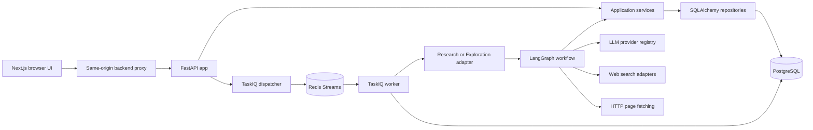
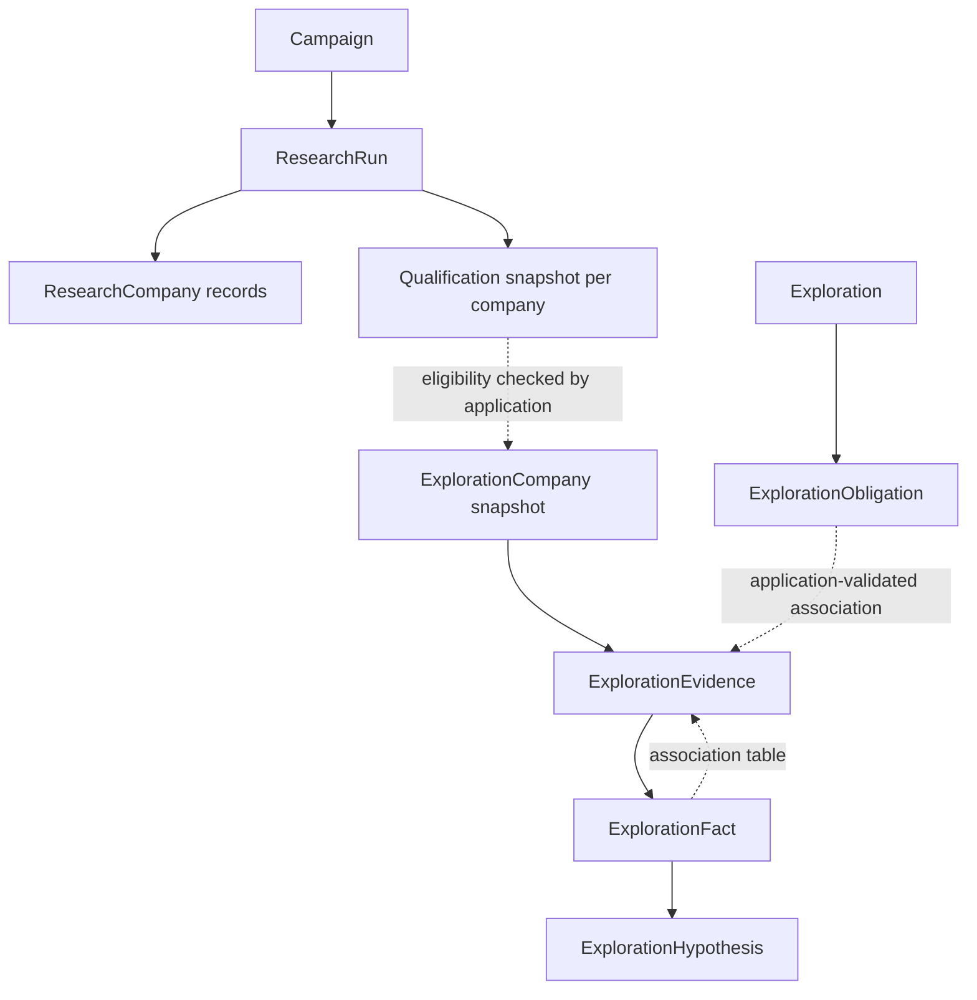

# Architecture

## Runtime components

The application has a browser frontend, FastAPI backend, PostgreSQL database,
Redis Streams broker, TaskIQ worker, and external model/search/fetch
integrations. The backend's service/repository split and asynchronous SQLAlchemy
access are described by root `AGENTS.md` and reflected in the main feature code.

Redis transports task messages; PostgreSQL stores business data and the
authoritative workflow execution ownership/status row. Do not treat queue
delivery as durable workflow state. See [Workflow execution](workflow-execution.md).

## Backend boundaries

- `src/virtual_company/main.py` creates the FastAPI application, registers
  routers, and controls lifespan startup/shutdown.
- `src/virtual_company/api/` defines HTTP routes, request/response schemas, and
  dependency wiring. `dependencies.py` supplies sessions and service/provider
  dependencies.
- `src/virtual_company/services/` coordinates business operations and
  validation; workflow-specific orchestration is in `workflows/`.
- `src/virtual_company/repositories/` contains SQLAlchemy persistence access.
- `src/virtual_company/db/` defines declarative models and session/base setup.
- `src/virtual_company/domain/` holds domain vocabulary/status concepts and
  should not depend on FastAPI per root instructions.
- `src/virtual_company/workflows/` contains LangGraph state, nodes, and graph
  construction. Nodes call services/integration abstractions and persist
  through repositories/services.

The intended request path is API → service → repository → database. The worker
path is TaskIQ task → workflow adapter → configured LangGraph workflow → nodes
and services → repositories/database.

## Application and API entry points

`src/virtual_company/main.py` includes route modules from `src/virtual_company/api/`:
`campaigns.py`, `explorations.py`, `research_companies.py`, and
`research_runs.py`, plus health handling. API paths are versioned under
`/api/v1`; inspect route decorators and API schemas for exact request/response
contracts. No authentication/authorization dependency was identified in these
route modules or app wiring; this observation does not cover infrastructure
controls outside the repository.

## Background execution

`src/virtual_company/task_queue/` implements broker setup, dispatch, task entry,
workflow adapters, heartbeats, terminal transitions, and stale-run
reconciliation. `src/virtual_company/repositories/workflow_execution.py`
coordinates the shared `workflow_execution` row with the corresponding
ResearchRun or ExplorationRun. The worker invokes the appropriate LangGraph
graph. Exact claim, duplicate-delivery, and recovery behavior is documented in
[Workflow execution](workflow-execution.md).

## Research to Exploration data flow

Solid arrows describe persisted ownership/association or derivation, while
dotted arrows include application-level validation/eligibility. In particular,
ResearchRun-to-qualification membership is represented by rows with foreign
keys; selection eligibility is checked in application code. Exploration
Evidence points to an ExplorationCompany and an ExplorationObligation, but the
database does not encode the shared-Exploration check as a composite foreign
key. Fact↔Evidence and Hypothesis↔Fact are many-to-many association tables.
See [Database schema](database-schema.md).

## Frontend/backend communication

The frontend is under `frontend/`, with App Router pages in
`frontend/src/app/`, feature-owned APIs/components under
`frontend/src/features/`, and shared transport in `frontend/src/lib/api/`.
Browser calls use a same-origin `/api/backend` proxy; server-only
`BACKEND_API_URL` points to the backend. TanStack Query handles fetch/cache,
status polling, and invalidation. Details are in [Frontend](frontend.md).

## External boundaries and deployment

Provider interfaces and implementations are under `src/virtual_company/llm/`
and `tools/`. Search providers include Exa and Tavily; page retrieval uses an
HTTPX-backed fetcher with configured limits and URL/network validation. The
Compose stack is defined in `docker-compose.yml`; see
[AI and integrations](ai-and-integrations.md) and
[Development and operations](development-and-operations.md).
