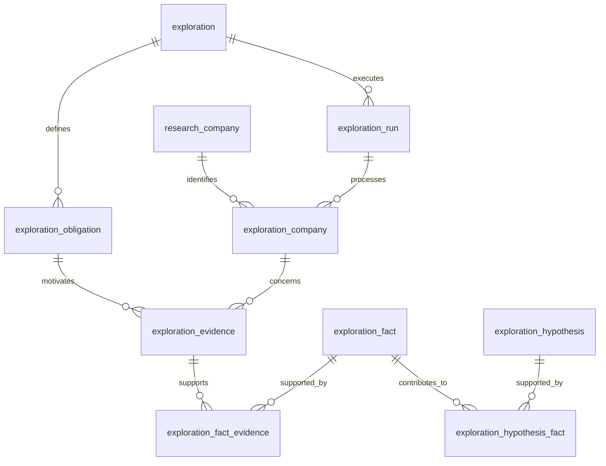

# Database Schema

## Research entities

These tables persist entities owned by the Research workflow.
Research-scoped table names are created directly by the project's initial schema.

Table: campaign

| Column                      | PostgreSQL type | Nullable | Description                                        |
|-----------------------------|-----------------|---------:|----------------------------------------------------|
| `id`                        | `UUID`          |       NO | unique ID campaign                                 |
| `name`                      | `VARCHAR(255)`  |       NO | name                                               |
| `description`               | `TEXT`          |      YES | detailed description                               |
| `target_market`             | `VARCHAR(255)`  |      YES | geographical market                                |
| `industry`                  | `VARCHAR(255)`  |      YES | targeted industry                                  |
| `keywords`                  | `JSONB`         |       NO | company concepts/signals used as campaign criteria |
| `company_size`              | `JSONB`         |      YES | optional direct integer min/max employee bounds    |
| `max_companies_to_research` | `INTEGER`       |       NO | campaign research cap; at least `target_count`     |
| `target_count`              | `INTEGER`       |       NO | desired eventual qualified-target count            |
| `status`                    | `VARCHAR(30)`   |       NO | campaign status                                    |
| `created_at`                | `TIMESTAMPTZ`   |       NO | created date                                       |
| `updated_at`                | `TIMESTAMPTZ`   |       NO | last change date                                   |
| `sealed_at`                 | `TIMESTAMPTZ`   |      YES | first run start; campaign definition is sealed     |

status:

- DRAFT
- RUNNING
- PAUSED
- COMPLETED
- FAILED

Indexes:

- PK (id)

Table: research_company

| Column            | PostgreSQL type | Nullable | Description          |
|-------------------|-----------------|---------:|----------------------|
| `id`              | `UUID`          |       NO | Internal ID          |
| `name`            | `VARCHAR(500)`  |       NO | company name         |
| `website`         | `VARCHAR(1000)` |      YES | web site             |
| `domain`          | `VARCHAR(255)`  |      YES | web domain           |
| `industry`        | `VARCHAR(255)`  |      YES | targeted industry    |
| `country`         | `VARCHAR(100)`  |      YES | country              |
| `state`           | `VARCHAR(255)`  |      YES | state                |
| `city`            | `VARCHAR(255)`  |      YES | city                 |
| `employee_number` | `INTEGER`       |      YES | number of employees  |
| `created_at`      | `TIMESTAMPTZ`   |       NO | company created date |
| `updated_at`      | `TIMESTAMPTZ`   |       NO | company updated date |

Indexes:

- PK (id)

Table: `campaign_target`

| Column        | Type        | Description                  |
|---------------|-------------|------------------------------|
| `campaign_id` | UUID        | campaign                     |
| `company_id`  | UUID        | company                      |
| `score`       | NUMERIC     | future qualification score   |
| `status`      | VARCHAR     | candidate/qualified/rejected |
| `created_at`  | TIMESTAMPTZ | created date                 |

Constraints:

- PK `campaign_target_pkey` (`campaign_id`, `company_id`)
- FK `campaign_target_campaign_id_fkey` (`campaign_id`) -> campaign (`id`)
- FK `campaign_target_research_company_id_fkey` (`company_id`) -> research_company (`id`)

Table: research_evidence

| Column            | PostgreSQL type | Nullable | Description                                     |
|-------------------|-----------------|---------:|-------------------------------------------------|
| `id`              | UUID            |       NO | Internal ID                                     |
| `company_id`      | UUID            |       NO | company                                         |
| `research_run_id` | UUID            |      YES | research execution that extracted this evidence |
| `criterion`       | VARCHAR(50)     |      YES | campaign criterion supported                    |
| `subject`         | VARCHAR(500)    |      YES | criterion value or subject                      |
| `claim`           | TEXT            |       NO | claim                                           |
| `evidence_text`   | TEXT            |       NO | evidence confirmation                           |
| `source_url`      | TEXT            |       NO | information source                              |
| `source_title`    | VARCHAR(500)    |      YES | source title                                    |
| `source_type`     | VARCHAR(50)     |      YES | careers/blog/news/etc                           |
| `confidence`      | NUMERIC(4,3)    |      YES | agent confidence                                |
| `observed_at`     | TIMESTAMPTZ     |       NO | when information was found                      |
| `created_at`      | TIMESTAMPTZ     |       NO | when evidence was saved                         |

Indexes:

- PK (id)
- `ix_research_evidence_research_run_id` (research_run_id)
- FK (company_id) -> research_company (id)
- FK (research_run_id) -> research_run (id)

Table: research_run

| Column            | PostgreSQL type | Nullable | Description                                 |
|-------------------|-----------------|---------:|---------------------------------------------|
| `id`              | UUID            |       NO | ID execution                                |
| `campaign_id`     | UUID            |       NO | campaign                                    |
| `status`          | VARCHAR(30)     |       NO | RUNNING/COMPLETED/FAILED                    |
| `started_at`      | TIMESTAMPTZ     |       NO | execution start time                        |
| `completed_at`    | TIMESTAMPTZ     |      YES | terminal completion time, including failure |
| `error`           | TEXT            |      YES | error text                                  |
| `companies_found` | INTEGER         |       NO | companies found                             |
| `created_at`      | TIMESTAMPTZ     |       NO | Run record creation time                    |

status:

- RUNNING
- COMPLETED
- FAILED

Indexes:

- PK (id)
- FK (campaign_id) -> campaign (id)

## Final qualification snapshots

Table: `research_company_qualification`

| Column             | PostgreSQL type | Nullable | Description                                     |
|--------------------|-----------------|----------|-------------------------------------------------|
| `id`               | UUID            | NO       | Snapshot ID                                     |
| `research_run_id`  | UUID            | NO       | FK to research_run(id)                          |
| `campaign_id`      | UUID            | NO       | FK to campaign(id)                              |
| `company_id`       | UUID            | NO       | FK to research_company(id)                      |
| `status`           | VARCHAR(30)     | NO       | QUALIFIED, NOT_QUALIFIED, INSUFFICIENT_EVIDENCE |
| `criteria_results` | JSONB           | NO       | Object containing a criteria array              |
| `created_at`       | TIMESTAMPTZ     | NO       | Database timestamp, default now()               |

Constraints:

- PK `research_company_qualification_pkey` (`id`)
- FK `research_company_qualification_research_run_id_fkey` (`research_run_id`) -> research_run (`id`)
- FK `research_company_qualification_campaign_id_fkey` (`campaign_id`) -> campaign (`id`)
- FK `research_company_qualification_research_company_id_fkey` (`company_id`) -> research_company (`id`)
- Unique constraint `uq_research_company_qualification_run_company` on
  `(research_run_id, company_id)`, also supporting lookups by run.
  Each criterion includes criterion, subject, status, evidence_ids (UUID strings),
  and reason. No Evidence content is copied. Retries replace status and JSON while
  preserving ID and created_at. Snapshots commit with research-run completion; no
  intermediate rounds or legacy-run backfill are stored.

Qualification snapshots contain only the automatic qualification result and
criterion-level results for that run/company pair.

## Exploration entities

These tables persist entities owned by the Exploration workflow. The workflow
uses Business Context to define Obligations, collects Evidence to support Facts,
and derives Hypotheses from Facts:

```text
Business Context
      ↓
Obligation
      ↓
Evidence
      ↓
Fact
      ↓
Hypothesis
```

Business Context explains why the Exploration exists. An Obligation is a
concrete requirement or question that guides discovery. Evidence is externally
collected supporting material, a Fact is a factual statement derived from
Evidence, and a Hypothesis is a higher-level inference derived from Facts.
Evidence, Facts, and Hypotheses are separate entities.

Table: `exploration`

Represents an Exploration definition and its high-level business context.

| Column             | PostgreSQL type | Nullable | Description        |
|--------------------|-----------------|---------:|--------------------|
| `id`               | UUID            |       NO | Exploration ID     |
| `business_context` | TEXT            |       NO | Business context   |
| `status`           | VARCHAR(30)     |       NO | Exploration status |
| `created_at`       | TIMESTAMPTZ     |       NO | Creation time      |
| `updated_at`       | TIMESTAMPTZ     |       NO | Last update time   |

Constraints:

- PK (`id`)

Indexes:

- PK (`id`)

Table: `exploration_obligation`

Represents an individual business requirement or question derived from the
Exploration business context and generated by the system. They are not
independently user-managed resources. Obligations remain first-class records so
evidence can identify the requirement that motivated its collection.

| Column           | PostgreSQL type | Nullable | Description                       |
|------------------|-----------------|---------:|-----------------------------------|
| `id`             | UUID            |       NO | Obligation ID                     |
| `exploration_id` | UUID            |       NO | Owning Exploration                |
| `description`    | TEXT            |       NO | Requirement or discovery question |
| `created_at`     | TIMESTAMPTZ     |       NO | Creation time                     |

Constraints:

- PK (`id`)
- FK (`exploration_id`) -> `exploration` (`id`)

Indexes:

- PK (`id`)
- `ix_exploration_obligation_exploration_id` (`exploration_id`)

Relationship: `exploration` 1 -> N `exploration_obligation`.

Table: `exploration_run`

Represents one execution of an Exploration.

| Column           | PostgreSQL type | Nullable | Description           |
|------------------|-----------------|---------:|-----------------------|
| `id`             | UUID            |       NO | Run ID                |
| `exploration_id` | UUID            |       NO | Exploration being run |
| `status`         | VARCHAR(30)     |       NO | Run status            |
| `started_at`     | TIMESTAMPTZ     |       NO | Execution start time  |
| `completed_at`   | TIMESTAMPTZ     |      YES | Completion time       |

Constraints:

- PK (`id`)
- FK (`exploration_id`) -> `exploration` (`id`)

Indexes:

- PK (`id`)
- `ix_exploration_run_exploration_id` (`exploration_id`)

Relationship: `exploration` 1 -> N `exploration_run`.

Table: `exploration_company`

Represents an existing `research_company` discovered or processed within one
Exploration run. It carries no duplicate company identity or profile data.

| Column               | PostgreSQL type | Nullable | Description                |
|----------------------|-----------------|---------:|----------------------------|
| `id`                 | UUID            |       NO | Exploration-company ID     |
| `exploration_run_id` | UUID            |       NO | Exploration run            |
| `company_id`         | UUID            |       NO | Related `research_company` |

Constraints:

- PK (`id`)
- FK (`exploration_run_id`) -> `exploration_run` (`id`)
- FK (`company_id`) -> `research_company` (`id`)
- Unique (`exploration_run_id`, `company_id`)

Indexes:

- PK (`id`)
- Unique index on (`exploration_run_id`, `company_id`), supporting run-to-company
  lookup
- `ix_exploration_company_company_id` (`company_id`), supporting company-to-run
  lookup

Relationships:

- `exploration_run` 1 -> N `exploration_company`
- `research_company` 1 -> N `exploration_company`

Table: `exploration_evidence`

Represents external supporting material collected while investigating an
`exploration_company`. `exploration_company_id` identifies who the evidence
concerns; `exploration_obligation_id` identifies why it was collected. Run
ownership is derived through `exploration_company` and does not need a duplicate
`exploration_run_id`.

| Column                      | PostgreSQL type | Nullable | Description                       |
|-----------------------------|-----------------|---------:|-----------------------------------|
| `id`                        | UUID            |       NO | Evidence ID                       |
| `exploration_company_id`    | UUID            |       NO | Company context for this evidence |
| `exploration_obligation_id` | UUID            |       NO | Obligation motivating collection  |
| `source_url`                | TEXT            |      YES | Source URL                        |
| `source_type`               | VARCHAR(50)     |      YES | Source classification             |
| `content`                   | TEXT            |      YES | Captured content or excerpt       |
| `created_at`                | TIMESTAMPTZ     |       NO | When evidence was saved           |

Constraints:

- PK (`id`)
- FK (`exploration_company_id`) -> `exploration_company` (`id`)
- FK (`exploration_obligation_id`) -> `exploration_obligation` (`id`)

Indexes:

- PK (`id`)
- `ix_exploration_evidence_exploration_company_id` (`exploration_company_id`)
- `ix_exploration_evidence_exploration_obligation_id`
  (`exploration_obligation_id`)

Table: `exploration_fact`

Represents a factual statement derived from one or more Evidence records.
Company context is derived through its supporting Evidence rather than stored
on the Fact.

| Column       | PostgreSQL type | Nullable | Description       |
|--------------|-----------------|---------:|-------------------|
| `id`         | UUID            |       NO | Fact ID           |
| `statement`  | TEXT            |       NO | Factual statement |
| `created_at` | TIMESTAMPTZ     |       NO | Creation time     |

Constraints:

- PK (`id`)

Indexes:

- PK (`id`)

Table: `exploration_fact_evidence`

Associates Evidence and Facts in a many-to-many relationship. One Fact can be
supported by multiple Evidence records, and one Evidence record can support
multiple Facts.

| Column                    | PostgreSQL type | Nullable | Description         |
|---------------------------|-----------------|---------:|---------------------|
| `exploration_fact_id`     | UUID            |       NO | Related Fact        |
| `exploration_evidence_id` | UUID            |       NO | Supporting Evidence |

Constraints:

- PK (`exploration_fact_id`, `exploration_evidence_id`)
- FK (`exploration_fact_id`) -> `exploration_fact` (`id`)
- FK (`exploration_evidence_id`) -> `exploration_evidence` (`id`)

Indexes:

- PK (`exploration_fact_id`, `exploration_evidence_id`), supporting Fact-to-
  Evidence lookup
- `ix_exploration_fact_evidence_exploration_evidence_id`
  (`exploration_evidence_id`), supporting Evidence-to-Fact lookup

Table: `exploration_hypothesis`

Represents a higher-level inference derived from one or more Facts. Company
provenance is derived through its Facts and their supporting Evidence rather
than stored on the Hypothesis.

| Column       | PostgreSQL type | Nullable | Description        |
|--------------|-----------------|---------:|--------------------|
| `id`         | UUID            |       NO | Hypothesis ID      |
| `statement`  | TEXT            |       NO | Inferred statement |
| `created_at` | TIMESTAMPTZ     |       NO | Creation time      |

Constraints:

- PK (`id`)

Indexes:

- PK (`id`)

Table: `exploration_hypothesis_fact`

Associates Facts and Hypotheses in a many-to-many relationship. One Hypothesis
can be supported by multiple Facts, and one Fact can contribute to multiple
Hypotheses.

| Column                      | PostgreSQL type | Nullable | Description        |
|-----------------------------|-----------------|---------:|--------------------|
| `exploration_hypothesis_id` | UUID            |       NO | Related Hypothesis |
| `exploration_fact_id`       | UUID            |       NO | Supporting Fact    |

Constraints:

- PK (`exploration_hypothesis_id`, `exploration_fact_id`)
- FK (`exploration_hypothesis_id`) -> `exploration_hypothesis` (`id`)
- FK (`exploration_fact_id`) -> `exploration_fact` (`id`)

Indexes:

- PK (`exploration_hypothesis_id`, `exploration_fact_id`), supporting
  Hypothesis-to-Fact lookup
- `ix_exploration_hypothesis_fact_exploration_fact_id`
  (`exploration_fact_id`), supporting Fact-to-Hypothesis lookup

### Provenance and domain invariants

The provenance chain is:

```text
Exploration
│
├── ExplorationObligation
│
└── ExplorationRun
       │
       └── ExplorationCompany ─────→ ResearchCompany
              │
              └── ExplorationEvidence
                     │
                     │ M:N
                     ▼
              ExplorationFact
                     │
                     │ M:N
                     ▼
              ExplorationHypothesis
```

The reasoning flow is Business Context → Obligation → Evidence → Fact →
Hypothesis. A Hypothesis can be traced through Facts and Evidence to its
`research_company` and the Obligation that motivated evidence collection.

All Evidence records supporting one Fact must belong to the same
`exploration_company`. All Facts supporting one Hypothesis must ultimately
resolve through their Evidence to the same `exploration_company`. These
same-company rules are enforced by application/domain logic; company ownership
is not duplicated on Fact or Hypothesis.


